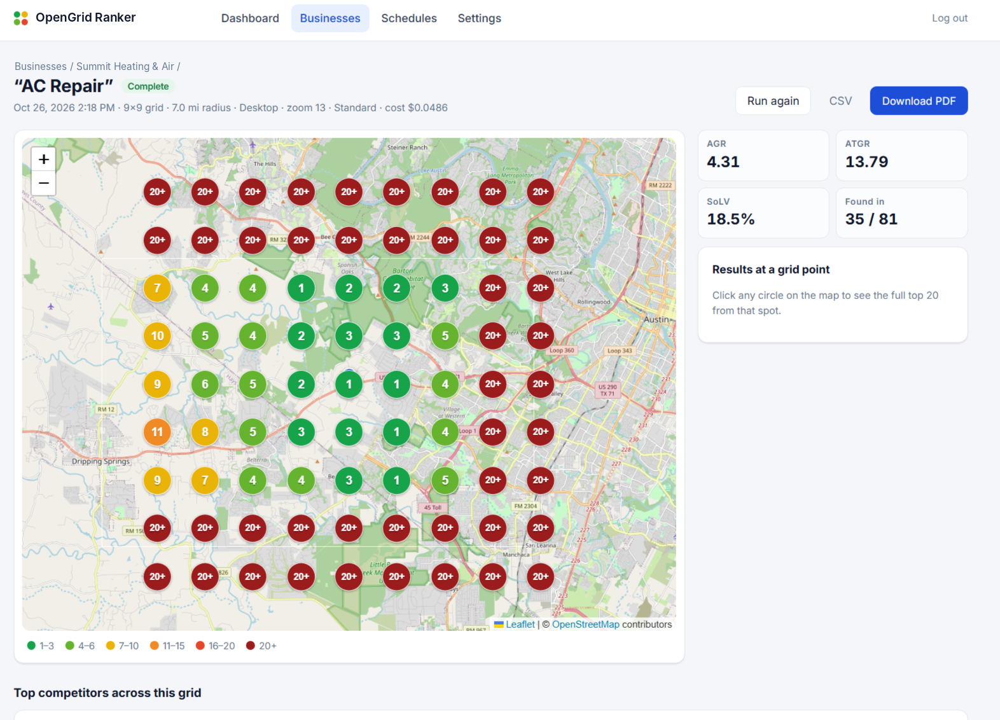

# OpenGrid Ranker

**A free, self-hosted local rank grid tracker.** See where a business ranks in Google Maps from every point across its service area, as a color-coded heatmap, without paying $25–$500 a month for a SaaS tool.



Google's map pack changes depending on where the searcher is standing. OpenGrid Ranker lays a grid of points over an area, checks the Google Maps rankings from each one through the [DataForSEO](https://dataforseo.com) API, and shows you exactly where a business is visible and where it disappears.

A typical 13×13 scan (169 points) costs about **$0.10** in DataForSEO credits. You pay DataForSEO directly; OpenGrid Ranker itself is free.

## Features

- **Heatmap scans** at any grid size and radius, with a live map preview and cost estimate before you run
- **AGR, ATGR and SoLV** metrics, the same ones the paid tools use
- **Click any point** to see the full top 20 from that spot
- **Competitor breakdown:** who owns the top 3 across the grid
- **Scan history** for each business and keyword, so you can see movement over time
- **Scheduled rescans** weekly, every two weeks or monthly
- **2-page PDF client reports** with your own logo, plus CSV export
- **Demo mode** with simulated results, so you can try everything before spending a cent
- **Team logins**
- Plain PHP + MySQL: runs on almost any shared host, no build step, no Node, no Docker

## Requirements

- PHP 8.1 or newer with the `curl` and `pdo_mysql` extensions (standard on most hosts)
- One MySQL or MariaDB database
- A DataForSEO account for real scans (not needed for demo mode)

---

## Install (about 15 minutes)

### 1. Pick where it lives
A subdomain such as `rank.yourdomain.com` keeps it separate from your main site. In your hosting panel, add the subdomain and note its folder. A subfolder of an existing site (for example `yourdomain.com/rank/`) also works.

### 2. Create a database
In your hosting panel (cPanel, Plesk or similar), create a new MySQL database and a database user with full access to it. Write down the database name, user, password and host (usually `localhost`).

### 3. Upload the files
[Download this repository as a ZIP](../../archive/refs/heads/main.zip) (or use **Code → Download ZIP** above), unzip it, and upload the contents into the folder where the tool will live, using your host's File Manager or SFTP. You should end up with `index.php`, `install.php`, `lib/`, `assets/` and so on directly in that folder.

> Some hosts won't let you unzip on the server. If so, unzip on your computer first and upload the files with an FTP program such as FileZilla.

### 4. Run the installer
Open `https://rank.yourdomain.com/install.php`, enter the database details and choose your login email and password. The installer creates the tables, writes `config.php` and sends you to the login page.

If it says the folder isn't writable, it shows you the contents of `config.php`. Create that file in the same folder through the File Manager, paste the contents in, and submit the installer again. (`config.sample.php` shows what the file looks like.)

After installing, you can delete `install.php`. It refuses to run again anyway.

### 5. Try it in demo mode
The tool starts in **demo mode**: every scan uses simulated results and costs nothing. Add a business and run a scan to see how everything works.

### 6. Connect DataForSEO
1. Sign up at [dataforseo.com](https://dataforseo.com). New accounts get a small free credit.
2. In your DataForSEO dashboard, open **API Access** and copy the **API login** and **API password**. These are different from your dashboard login.
3. Add funds when you're ready. DataForSEO has a $50 minimum top-up, which covers roughly 500 13×13 scans.
4. In OpenGrid Ranker, go to **Settings**, paste the API login and password, untick **Demo mode** and save. You should see "Connected to DataForSEO" with your balance.

Real scans now run against Google Maps. Demo scans stay in your history, marked "demo"; delete them whenever you like.

### 7. Set up the background job
Scheduled scans, and queued scans when nobody has the page open, need a job that runs every 5 minutes.

**Easiest:** create a free account at [cron-job.org](https://cron-job.org), add a job that opens the URL shown under **Settings → Background job** every 5 minutes, and save. The URL contains a secret key, so keep it private.

**If your host offers cron jobs:** `*/5 * * * * php /path/to/opengrid-ranker/cron.php`

The dashboard warns you if schedules exist but the job hasn't run in the last hour.

---

## Using it

**Add a business.** Search Google Maps by name and city (one live request, about $0.002), or paste the business's Google Maps link. OpenGrid Ranker matches rankings by the business's **CID** (Google's numeric listing ID), which stays reliable even if the name changes. Without a CID or Place ID it falls back to an exact name match.

**Run a scan.** Choose a keyword, grid size and radius. The map preview shows exactly where each point lands, and the estimate shows the cost before you run. Click the map or drag the pin to move the grid center, which is handy for service-area businesses.

| Speed | Typical time | Cost per point | 13×13 scan |
|---|---|---|---|
| Standard queue | 1–5 min | $0.0006 | ~$0.10 |
| Priority queue | ~1 min | $0.0012 | ~$0.20 |
| Live | about 1 min | $0.002 | ~$0.34 |

Standard is the right default for scheduled scans. Use Live when you're on a call with a client. Prices are DataForSEO's and may change; check [their pricing page](https://dataforseo.com/pricing/serp/google-maps-serp-api).

**Read the results.** Click any circle to see the full top 20 at that spot. The competitor table shows who owns the top 3 across the grid.

- **AGR (Average Grid Rank):** average rank where the business appears in the top 20.
- **ATGR (Average Total Grid Rank):** average across every point, counting "not in top 20" as 21. This is the most honest single number.
- **SoLV (Share of Local Voice):** share of points where the business ranks 1–3.

**PDF reports.** Click **Download PDF** on any finished scan for a 2-page client report (heatmap, metrics, top competitors, plain-English definitions). To put your logo in the report header, upload `logo.png` (or `logo.jpg`) next to `index.php`; a wide logo about 3× as wide as it is tall looks best. Reports use the tool name you chose during install (stored in `config.php` as `app_name`).

**Schedule.** Choose Weekly, Every 2 weeks or Monthly under Repeat when starting a scan. Manage them on the Schedules page.

**Team.** Add logins for teammates under Settings.

---

## Good to know

- **Zoom** (under Advanced) is the map zoom DataForSEO simulates at each point. 13 suits a city; use 14–15 for dense downtown grids. Keep it the same between scans of the same keyword so results stay comparable.
- **Map tiles** come from OpenStreetMap, which is fine for light use. If you run a lot of scans or have many users, switch to another tile provider in Settings, per the [OpenStreetMap tile usage policy](https://operations.osmfoundation.org/policies/tiles/).
- **Costs** are recorded per scan from DataForSEO's own billing, and the dashboard shows this month's total.
- **Backups:** everything lives in the MySQL database, so back that up (most hosts do this automatically).
- **Security:** pages require a login, forms are protected against cross-site requests, passwords are hashed, and the background-job URL needs its secret key. `.htaccess` blocks direct access to `config.php` and `lib/` on Apache; on Nginx, add equivalent rules. The DataForSEO API password is stored in your database because the tool needs it to make requests.
- **Local testing:** the installer also offers SQLite, which is handy for trying OpenGrid Ranker on your own computer (`php -S localhost:8000`). Use MySQL on a real server.
- **Data source:** DataForSEO collects Google results on your behalf. That's how every grid tracker works, but you're responsible for using it within DataForSEO's and Google's terms.

## Files

```
index.php        dashboard
businesses.php   list / add businesses
business.php     one business: keyword cards, scan history, schedules
scan_new.php     start a scan (map preview + cost estimate)
scan.php         heatmap, metrics, competitors, point details
schedules.php    recurring scans
settings.php     DataForSEO, defaults, background job, team logins
cron.php         background job
api.php          JSON used by the pages
export.php       CSV export
install.php      one-time installer
lib/             engine: database, grid math, DataForSEO client, scans, demo data
assets/          styles and map code
```

## Contributing

Bug reports and pull requests are welcome. Please don't include API credentials, `config.php` or real client data in issues or PRs.

## License

[MIT](LICENSE). Free to use, change and share, including commercially.

Built by [TastyPlacement](https://tastyplacement.com).
